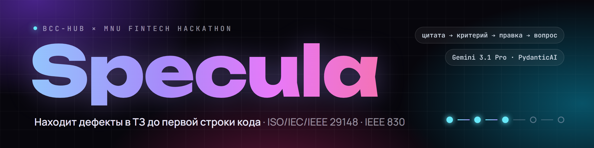

<div align="center">



# Specula

### Агент, который до начала разработки находит дефекты в документе требований по ISO/IEC/IEEE 29148 · IEEE 830

Консольная команда — `reqaudit`

`Python 3.12` &nbsp;·&nbsp; `PydanticAI` &nbsp;·&nbsp; `Gemini 3.1 Pro (Vertex AI)` &nbsp;·&nbsp; `FastAPI` &nbsp;·&nbsp; `uv`

[Польза для банка](#польза-для-банка) · [Быстрый старт](#быстрый-старт) · [Как это работает](#как-это-работает) · [Как мы мерили качество](#как-мы-мерили-качество) · [Результаты](#результаты) · [Журнал улучшений](#журнал-улучшений) · [Что дальше](#что-дальше)

</div>

<div align="center">

[](https://youtu.be/G3kuoDSiECM)

<sup>Видео-демо Specula — <a href="https://youtu.be/G3kuoDSiECM">youtu.be/G3kuoDSiECM</a></sup>

</div>

> **Зачем это нужно:** противоречие между разделами ТЗ или не заданное правило обнаруживаются обычно на тестировании, когда код уже написан. Specula читает документ в любом формате, нарезает его на требования, проверяет каждое и набор целиком по стандартам и отдаёт автору отчёт на русском: дефект → цитата из документа → пункт стандарта → правка → вопрос, который надо задать автору.

| | |
| --- | --- |
| **Запуск** | `uvx --from git+https://github.com/VllSunday/hackathon-fintech-bcc-hub reqaudit требования.pdf отчёт.md` — ключ и подробности в [Быстром старте](#быстрый-старт) |
| **Видео-демо** | [youtu.be/G3kuoDSiECM](https://youtu.be/G3kuoDSiECM) |
| **Презентация** | [docs/presentation.html](docs/presentation.html) — открывается в браузере; ← → листать, N — текст для озвучки |
| **Отчёт по документу организаторов** | [Markdown](docs/examples/organizers.report.md) · [HTML, открывается двойным кликом](docs/examples/organizers.report.html) · [вопросы автору](docs/examples/organizers.answers.md) — по выданному файлу `requirements.md`; тот же документ в PDF: [отчёт](docs/examples/organizers-pdf.report.md). Оба сделаны агентом v0.2.1, коммит в паспорте отчёта |
| **Модель и версия в паспорте отчёта** | `vertex:gemini-3.1-pro-preview`, агент 0.2.1 (тег `v0.2.1`). «Ответов из кэша: 29» в паспорте означает, что отчёт пересобран из кэша ответов модели, полученных прогонами того же кода: так паспорт указывает чистый коммит. Прогон с нуля той же командой с флагом `--no-cache` вызывает модель заново: около 30 минут и $4–5 |
| **Качество** | Документ организаторов: из 21 находки независимая проверка подтвердила **12 настоящих дефектов, ошибочных — 0**, включая противоречия Ф-3 ↔ Ф-4 и Ф-2 ↔ критерий приёмки. На документах с эталоном: N1 — полнота **91%** и точность **84%** по смыслу, N2 — полнота **85%** по смыслу, F1 — реальная точность **≈80%** |

<a href="docs/img/flow.svg"></a>

<div align="center"><sup>Путь документа от файла до отчёта: облёт схемы по фазам. <a href="docs/img/flow.svg">Схема целиком</a> · <a href="#как-это-работает">по фазам с пояснениями</a> · <a href="#как-выглядит-отчёт">как выглядит отчёт</a></sup></div>

Задание: [BCC-HUB/ai-requirements-validator-task](https://github.com/BCC-HUB/ai-requirements-validator-task) · хакатон [BCC-HUB × MNU FinTech](https://bcchubagents.mnu.kz/).

## Что умеет

| Возможность | Что решает | Где видно |
| --- | --- | --- |
| **Любой формат на входе** | PDF, скан, DOCX, HTML, RTF, Markdown, текст; картинки и диаграммы читает модель | Блоки документа с номером страницы или строки |
| **Нарезка на требования** | Выделяет требования там, где нумерации нет: user stories, сплошной текст, таблицы | Вкладка «Нарезка», индекс R-… |
| **19 критериев качества** | 29148 п. 5.2.5 (требование), п. 5.2.6 (набор), IEEE 830 п. 4.3; у каждого критерия карточка с проверкой и границами | Критерий и пункт стандарта в каждой находке |
| **Межраздельные противоречия** | Часть A против части B, требование против API, правило против критерия приёмки | Обе цитаты в находке |
| **Уточняющие вопросы автору** | Вопрос на каждый критичный и существенный дефект, с адресатом и флагом «блокирует разработку». Автор отвечает прямо в интерфейсе, в файле или в терминале; агент перепроверяет затронутые находки | Вкладка «Вопросы автору» с полями ответа, файл `*.answers.md` |
| **Вывод для команды** | «Можно ли начинать разработку» и что исправить первым | Карточка вывода в начале отчёта |

Каждая находка в отчёте подкреплена дословной цитатой: код проверяет, что цитата есть в документе, иначе находка не попадает в отчёт.

## Польза для банка

Дефект требований, найденный на тестировании или в проде, стоит переделки кода, тестов и иногда денег клиентов. Specula переносит эту находку на день, когда ТЗ только написано.

| Кто | Что получает | Пример из наших прогонов |
| --- | --- | --- |
| **Аналитик, автор ТЗ** | Список дефектов с цитатой и правкой, вопросы к себе же до ревью; ответы вписываются в интерфейсе, агент перепроверяет | «Ф-3: один push в месяц» против «Ф-4: push после смены порога» — документ организаторов |
| **Владелец продукта** | Вывод «можно ли начинать разработку» и что исправить первым, без чтения всего отчёта | 7 критичных дефектов в ТЗ на 13.5 КБ → «Нет», первые правки списком |
| **Разработка и QA** | Межраздельные противоречия «бизнес-требование ↔ API», которые иначе всплывают на интеграции | лимит 30 000 ₸ в требованиях и 50 000 ₸ в API; порог в тенге, а хранится в тиынах (N2) |
| **Комплаенс и безопасность** | Отдельный признак: можно ли по тексту обойти обязательную проверку или потерять деньги и данные | при недоступности ГБД ФЛ заявка уходит на одобрение мимо проверок ПОД/ФТ (F1); полная фамилия в ответе API вопреки требованию (N1) |

| Свойство | Почему важно банку |
| --- | --- |
| Каждое замечание — с дословной цитатой, проверенной кодом | Отчёту можно верить: ни одной выдуманной находки на документе организаторов по независимой проверке |
| Скрытый текст и встроенные инструкции для ИИ становятся находкой | Документ из внешнего источника не управляет проверкой |
| Ключ модели только на сервере, документ читается локально | Наружу уходят только запросы к выбранной модели; провайдер задаётся настройкой (Vertex AI, OpenAI, Anthropic; локальная модель через ollama подключается, но на качество не проверялась) |
| Консольная команда с кодами возврата, отчёт в Markdown и одним HTML-файлом | Встраивается в процесс: проверка ТЗ перед передачей в разработку, отчёт прикладывается к задаче |
| Цена проверки | ≈ $5 на ТЗ в 15–40 КБ на Gemini 3.1 Pro, ≈ $0.2 на бесплатной модели; повторный показ того же отчёта и перепроверка по ответам автора берут готовое из кэша |

### Как выглядит отчёт


<div align="center"><sup>Отчёт в веб-интерфейсе: вывод, первые правки, документ с цитатами и находки. Тот же отчёт пишется в Markdown и одним HTML-файлом.</sup></div>

## Быстрый старт

**1. Ключ модели.** Бесплатный — в [Google AI Studio](https://aistudio.google.com/apikey): «Create API key», без карты. Для лучшего качества — ключ Google Cloud с доступом к Vertex AI (начинается с `AQ.`), с ним агент сам выберет Gemini 3.1 Pro.

**2. Куда положить.** В файл `.env` в папке, откуда запускаете агента (образец — [.env.example](.env.example)):

```bash
echo "GEMINI_API_KEY=ваш-ключ" > .env
```

**3. Запуск.** Нужен только [uv](https://docs.astral.sh/uv/getting-started/installation/), он сам поставит Python и зависимости:

```bash
uvx --from git+https://github.com/VllSunday/hackathon-fintech-bcc-hub reqaudit требования.pdf отчёт.md
```

**4. Куда ляжет отчёт.** В `отчёт.md` (второй аргумент; без него — `reports/<имя документа>.report.md`). Рядом — `отчёт.answers.md` с вопросами автору; с флагом `--html` ещё и `отчёт.html` одним файлом. Все промежуточные артефакты — в `runs/<идентификатор прогона>/`.

**Какую модель выбрать** (имена моделей на 27.11.2026, документ организаторов, 13.5 КБ):

| Ключ | Модель | Результат | Время, цена |
| --- | --- | --- | --- |
| Бесплатный AI Studio | `gemini-3.5-flash-lite` | 13 находок, 2 критичных: GET вместо записи, нет метода чтения, `amount` целое в запросе и строка в ответе, 200 против 400. Пропущены Ф-2 ↔ критерий приёмки и проверка «активная карта KZT» | 21 запрос к модели; около 1.5 мин без ограничений частоты, на бесплатном тарифе — дольше: агент ждёт лимит, `REQAUDIT_RPM` задаёт темп |
| Google Cloud (Vertex AI) | `gemini-3.1-pro-preview`, запасная `gemini-3.5-flash` | 20 дефектов и 1 замечание; по независимой проверке 12 настоящих дефектов, 0 ошибочных; найдены Ф-3 ↔ Ф-4, Ф-2 ↔ приёмка, «активная карта KZT» | около 30 запросов, 20 мин, ≈ $4.0 |

Время на pro в основном уходит на ожидание лимита частоты (ответы 429): агент пережидает его до 5 минут, а не переключается на слабую модель, поэтому результат не зависит от загрузки провайдера. Повторный прогон того же документа берётся из кэша и занимает секунды.

<details>
<summary>Установка uv, другие модели, веб-интерфейс, запуск из клона</summary>

**uv** (сам ставит Python):

```powershell
powershell -ExecutionPolicy ByPass -c "irm https://astral.sh/uv/install.ps1 | iex"   # Windows
```

```bash
curl -LsSf https://astral.sh/uv/install.sh | sh                                     # macOS, Linux
```

**Модель выбирается по ключу автоматически:**

| Ключ в `.env` | Модель | Запасная |
| --- | --- | --- |
| `GEMINI_API_KEY=AQ.…` (ключ Google Cloud) | `vertex:gemini-3.1-pro-preview` | `vertex:gemini-3.5-flash` |
| `GEMINI_API_KEY` из AI Studio | `gemini:gemini-3.5-flash-lite` | — |
| `OPENAI_API_KEY` | `openai:gpt-5.5` | вторая из найденных |

Задать модели по ролям можно переменными `REQAUDIT_MODEL_<РОЛЬ>`, см. [.env.example](.env.example). Модели `*-preview` Google может переименовать; тогда новое имя задаётся той же переменной.

**Веб-интерфейс** (тот же агент: загрузка документа, ход прогона, отчёт с цитатами в тексте документа, ответы на вопросы):

```bash
uvx --from git+https://github.com/VllSunday/hackathon-fintech-bcc-hub reqaudit-ui
```

Откроется `http://127.0.0.1:8000/`. Страница работает без интернета, ключ читает только сервер.

**Из клона:**

```bash
git clone https://github.com/VllSunday/hackathon-fintech-bcc-hub.git && cd hackathon-fintech-bcc-hub
uv run reqaudit corpus/inputs/organizers/requirements.md отчёт.md --html
```

</details>

## Как это работает

Документ проходит четыре фазы, ниже каждая отдельным кадром. [Вся схема одной картинкой](docs/img/flow.svg); интерактивная версия с переходами по фазам — [docs/agent-flow.html](docs/agent-flow.html), открывается в браузере.

<sub>Цвета: серый — код, зелёный — вызов модели по схеме, фиолетовый — агент с инструментами, жёлтый — гейт (вычисляется кодом, а не утверждается моделью), оранжевый — вход, человек или результат. Пунктирная рамка — шаг, который выполняется не всегда.</sub>

**1. Чтение файла, s0–s1.** PDF читается тремя независимыми способами, текстовые форматы — терпимым парсером, расхождения прочтений решает модель по картинке страницы. Прочтения нужны разные, потому что ломаются по-разному: у одной PDF-презентации текстовый слой молча потерял латиницу и цифры, и поймала это только сверка с изображением страницы.


**2. База и план проверки, s2–s4.** Блоки с якорями, реестр требований и таблица фактов складываются в базу документа. Дальше агенты не ищут по файлу, а проверяют и доказывают по базе. Ячейки проверки строит код из профиля документа.


**3. Проверка ячеек, s5–s6.** Ячейка — одно требование с группой критериев или пара-кандидат в противоречие, ячейки работают параллельно. В каждой аналитик ищет дефект, код проверяет схему ответа и цитату, оппонент пытается опровергнуть находку, арбитр решает спорное. Затем калибровка выставляет серьёзность всем подтверждённым находкам вместе и вслепую: модель не видит уровня рецензента и не выбирает уровень, а отвечает на вопросы о последствии каждой находки; уровень по ответам ставит таблица в коде, итог — медиана трёх независимых оценок.


**4. Доказательство и выдача, s7–s9.** Гейты пропускают в отчёт только находки с найденной цитатой, редактор сводит дубли и пишет вопросы автору. Если автор ответил файлом или в терминале, s8b перепроверяет затронутые находки; без ответов отчёт собирается сразу.


Каждый вызов модели проходит через кэш ответов на диск, трассу `trace.jsonl` и лимитер с повторами и запасной моделью; промпты лежат файлами, их хэш попадает в паспорт прогона. Картинки собираются из `docs/agent-flow.html` скриптом `uv run python scripts/export_flow.py`.

Принцип: **гибкость даёт модель, инварианты держит код.** Модель читает, судит и формулирует. Код проверяет то, что можно проверить без суждения: цитата есть в документе, каждый блок учтён, каждый пункт чек-листа разобран, уровень серьёзности не противоречит ответам модели.

| Этап | Что делает модель | Что гарантирует код |
| --- | --- | --- |
| **s1 чтение** | Читает сканы и картинки (два независимых прочтения скана со сверкой) | Тип по содержимому, скрытый текст становится находкой, каждый блок с якорем |
| **s2 нарезка** | Профиль документа, границы требований по смыслу | Каждая цитата требования есть в документе; явные «обязан/must» вне требований включают проверку всего документа целиком |
| **s3 факты** | Значения, единицы, сроки, статусы с цитатами | Сверяет значения одного параметра, тенге против тиынов, разные единицы времени |
| **s4 план** | Предлагает до 5 проверок под содержание документа | Ячейки проверки по профилю: требования, набор, часть A ↔ B, критерии приёмки, полнота, значения |
| **s5 рецензенты** | Ищут дефекты по карточкам критериев | «Сначала перечисли, потом суди»: матрица прослеживаемости, чек-лист полноты на каждый срок и статус из таблицы фактов |
| **s6 оппонент, арбитр, калибровка** | Пытаются опровергнуть каждую находку; калибровщик отвечает на вопросы о последствии каждой | Пропуск опровергается только цитатой, отвечающей на его вопрос; уровень серьёзности ставит таблица (`level()` в `stages/s6_calibrate.py`), медиана трёх оценок |
| **s7 гейты** | — | Без найденной цитаты и с одной стороной противоречия — не в отчёт. Сверка контракта API: одно поле с разными типами в таблицах запроса и ответа (`integer` против `string`) — находка от кода, модель её не судит |
| **s8 редактор** | Сводит дубли, пишет вопросы автору с адресатом | Каждый critical и major покрыт вопросом |

<details>
<summary>Почему такая архитектура: решения, к которым мы пришли по замерам</summary>

| Решение | Что было до | Почему так |
| --- | --- | --- |
| Оппонент на каждую находку, арбитр на спорные | Рецензент сам решал, что дефект | Ложная находка в отчёте подрывает доверие сильнее пропущенной |
| Один общий фрагмент «что считается пропуском» у рецензента, оппонента и арбитра | Правила жили в разных промптах | Оппонент верно отсекал придирку, а арбитр её возвращал, потому что не знал правила (журнал, H20) |
| Чек-лист полноты обязан покрыть каждый срок, лимит и статус из таблицы фактов | Модель сама решала, что перечислить | Модель пропускала статусы и сроки, а важный пропуск помечала «в порядке, некритично» (H21) |
| Калибровка вслепую: вопросы о последствии, уровень по таблице в коде, медиана трёх оценок | Рецензент ставил уровень про свои 3–5 находок, потом один вызов калибровки его поправлял | Оценённые поодиночке, находки кажутся важными; показанный уровень рецензента калибровщик подтверждал в 25 случаях из 29; одна выборка от прогона к прогону гуляла |
| Карточки критериев и одна шкала серьёзности для всех ролей | Названия критериев и ссылки на стандарты | Модель различает соседние критерии по границам из карточки, а не по названию |
| Лимит запросов пережидается до 5 минут, кэш читается только для вызываемой модели | Через минуту ожидания вызов уходил на flash; ответ flash жил в кэше дальше | В двух прогонах треть проверок незаметно сделала слабая модель |

</details>

## Как мы мерили качество

Без замеров баланс между кодом и моделью остаётся предположением. Поэтому до цикла улучшений мы собрали корпус и стенд.

**Корпус** — 8 документов с эталонной разметкой ([corpus/](corpus/README.md)). Документы сгенерированы отдельной моделью с посеянными дефектами и ловушками: фразами, которые выглядят как дефект, но им не являются.

| Документ | Форма | Объём | Дефектов в эталоне (критичных) | Ловушек |
| --- | --- | --- | --- | --- |
| N1 `transfers_by_phone` | шаблон организаторов, часть A + REST API | 23 КБ | 23 (12) | 6 |
| N2 `autopayment_mobile` | шаблон организаторов | 43 КБ | 20 (7) | 7 |
| F1 `sme_onboarding_stories` | user stories, Gherkin | 41 КБ | 35 (9) | 6 |
| F2 `fraud_alerts_gost34` | ТЗ по ГОСТ 34 | 44 КБ | 23 (3) | 7 |
| F3 `sme_credit_pipeline_large` | большой документ | 116 КБ | 46 (9) | 8 |
| D1 `marketing_no_requirements` | не спецификация | 7 КБ | 0 | 3 |
| D2 `injection_note` | встроенная инструкция для ИИ | 16 КБ | 6 (2) | 6 |
| `tricky.pdf` | PDF со скрытым текстом и картинкой | — | 4 | — |

Документ организаторов в эталоны не входит намеренно: под него мы не подстраивались.

**Инструменты** — всё сравнивается без вызовов модели, по сохранённым прогонам:

| Команда | Что делает |
| --- | --- |
| `reqaudit-eval <эталон> <прогоны…>` | Полнота, точность, совпадение критерия и серьёзности, ложные срабатывания на ловушках; находка совпадает с дефектом по месту (цитатам), а не по словам |
| `reqaudit-eval --by-meaning` | Второй проход сопоставления по смыслу для находок, процитировавших соседнее место |
| `reqaudit-bench` | Прогон нескольких документов и вариантов настроек, сводная таблица со стоимостью и временем |
| `reqaudit-diagnose <прогон>` | Разбор трассы: куда ушли деньги, какие находки отсеял оппонент и почему, какие проверки упали |

**Независимая проверка.** Эталон тоже может ошибаться, поэтому спорные места судили отдельные экземпляры Claude. Они видели только документ и шкалу, без промптов агента, эталона и ответов агента.

| Что проверяли | Как | Итог |
| --- | --- | --- |
| Находки агента вне эталона | Вердикт «настоящий / придирка / ошибка / дубль» по каждой | В эталон F1 добавлено 17 подтверждённых дефектов, в N1 — 5; 2 наших добавления в N1 признаны ошибкой и убраны |
| Серьёзность эталона | Два оценщика независимо по одной шкале | Друг с другом согласны в 88% (F1), 91% (N1) и 95% (N2), с исходным эталоном — в 44%, 57% и 90%; 20 уровней исправлены по их общему мнению |
| Калибровка серьёзности | Разработка на 131 паре «находка — уровень эталона» из сохранённых прогонов N1 и F1; документ организаторов — отложенная проверка, на нём ничего не настраивалось | Без калибровки 77%, старая 82%, вслепую по таблице **85.5%**; на документе организаторов 10 → 14 из 20 |

## Результаты

Все числа — из сохранённых прогонов, пересчитанных против текущих эталонов: база на `gemini-3.5-flash`, итог на `gemini-3.1-pro-preview`. «Полнота» и «точность» считаются строго, по совпадению цитат. Точность по смыслу выше: часть находок вне эталона — настоящие дефекты, которых генератор не заложил.

**N1 — шаблон организаторов на незнакомом содержании** (23 дефекта):

| | База (flash) | Итог |
| --- | --- | --- |
| Полнота | 65% (15/23) | **78%** (18/23), по смыслу **91%** |
| Найдено критичных | 8 из 12 | **10 из 12** |
| Точность | 52% | **72%**, по смыслу **84%** |
| Серьёзность совпала | 14 из 15 | **17 из 18 (94%)** |
| Ложных на ловушках | 2 из 6 | 1 из 6 |
| Стоимость, время | $3.30, 9 мин | $5.63, 59 мин |

**F1 — незнакомая форма: user stories** (35 дефектов):

| | База (flash) | Итог |
| --- | --- | --- |
| Полнота | 43% (15/35) | **66%** (23/35) |
| Найдено критичных | 3 из 9 | **7 из 9** |
| Точность по эталону | 75% | **79%** |
| Реальная точность (независимая проверка) | — | **≈80%** (было ≈70% до правок H18–H20) |
| Серьёзность совпала | 11 из 15 (73%) | **84%** (64 из 76 по трём прогонам pro; без калибровки 74%) |

**N2 — шаблон организаторов, автоплатежи** (20 дефектов). Первый прогон v0.2.0 был отложенной проверкой: на этом документе ничего не настраивалось. Затем по его пропуску исправлено извлечение фактов, поэтому последний столбец — уже не чистая отложенная проверка:

| | База (flash, до цикла) | v0.2.0 (pro) | + единицы хранения в фактах |
| --- | --- | --- | --- |
| Полнота | 85% (17/20), по смыслу 90% | 70% (14/20), по смыслу 75% | **80%** (16/20), по смыслу **85%** |
| Найдено критичных | 7 из 7 | 5 из 7 | **6 из 7** |
| Реальная точность (независимая проверка) | — | **≈75%** (24 из 32), ошибочная 1, придирок 7 | точность по эталону та же (43% против 44%) |
| Серьёзность совпала с эталоном | 13 из 17 (76%) | **11 из 14 (79%)** | **13 из 16 (81%)** |
| Стоимость, время | $3.73, 9 мин | $8.39, 58 мин | столько же с нуля; правило добавляет факты, а не вызовы |

Пропуски разобраны по трассе. «Порог в тенге записывается в поле в тиынах» в первом прогоне не нашёл никто: таблица фактов не выписывала единицу хранения поля, и кодовой сверке не с чем было сравнить. После правки s3 расхождение «₸ / тенге / тиыны» в таблице появляется, но рецензент сверки значений счёл его законным исключением («в API для порога прямо сказано: в тенге») и не учёл, что база хранит порог в тиынах без описанного пересчёта. «3 повторные попытки против 2» найдено, но в первом прогоне редактор слил его с соседней находкой: оно видно внутри сводной находки.

**Документ организаторов** — итоговая версия, эталона нет. Готовый отчёт: [docs/examples/organizers.report.md](docs/examples/organizers.report.md), вопросы автору: [organizers.answers.md](docs/examples/organizers.answers.md).

| Прогон | Результат |
| --- | --- |
| Агент (v0.2.1), выданный `requirements.md` | 36 требований, 20 дефектов (7 критичных) и 1 замечание, 18 вопросов автору (7 блокируют разработку); прогон ≈ $5 и 30 минут, в паспорте отчёта меньше: неизменившиеся этапы взяты из кэша |
| Независимая проверка находок | **12 настоящих дефектов, ошибочных 0**, 7 придирок, 2 дубля |
| Тот же документ в PDF | 43 требования, 19 дефектов (4 критичных) и 4 замечания, $4.85, 31 минута. Проверка: 13 настоящих, 7 придирок, 2 дубля и 1 ошибочная (за требование принята преамбула составителя); серьёзность верна в 15 из 22 |
| После сверки контракта API (`contract.py`) | Отчёт в `docs/examples` сделан версией v0.2.1. Текущая версия добавляет к нему две находки, найденные кодом без модели: поля `amount` и `enabled` — `integer` в параметрах запроса и `string` в ответе. На 7 документах корпуса сверка ложных срабатываний не дала |
| Найдено | Ф-3 ↔ Ф-4 (один push в месяц против push после смены порога), Ф-2 против критерия приёмки (покупка 31 января), нет проверки «активная карта KZT» в API, нет метода чтения настроек и суммы за месяц, «проведённые покупки» — авторизация или списание, 400 против 200 с `result=ERROR`, GET для изменения данных, «прежнее состояние» при ошибке |
| Пропущено | Сравнение расходов в тиынах с порогом в тенге без правила, привязка возврата к исходной покупке, выключенное уведомление, покупки в другой валюте, `amount` целое в запросе и строка в ответе, идентификатор карты в строке GET-запроса, пустой Prod URL, приёмка не покрывает Ф-3, Ф-4, возвраты и границы |
| Серьёзность | Против уровней независимого проверяющего: версия 0.1.0 — 10 из 20, версия 0.2.x — 14 из 20 в отложенном замере, 12 из 19 в итоговом отчёте. Все расхождения итогового отчёта — завышение: оформление API (Content-Type, 201, 403) и общая устойчивость к сбоям отмечены как существенные |

**Тесты:** 211 автотестов без обращения к модели (`uv run pytest`), линтер `ruff` чистый. Тесты проверяют не только код, но и поведение конвейера на подменной модели: что оппонент отсекает находку, арбитр решает спор, калибровка не нарушает шкалу, чек-лист не пропускает статусы.

## Журнал улучшений

<details>
<summary>Гипотеза → правка → замер: 14 шагов цикла качества и что сломалось по дороге</summary>

Цикл: гипотеза → правка → прогон одного документа → разбор трассы → следующая гипотеза. Каждая правка общая, под конкретный текст ничего не подгонялось. Числа ниже — N1, строго по цитатам; шаги 1–6 в основном на flash (часть ролей на pro), с шага 7 все роли на pro; разброс между двумя прогонами одной версии доходит до ±10 п. п., поэтому решения принимались по трассе, а не по одной цифре.

| Шаг | Гипотеза → правка | Полнота | Точность |
| --- | --- | --- | --- |
| База | Конвейер s0–s9 на flash | 65% | 52% |
| 1 | Полнота «сначала перечисли, потом суди»: чек-лист по внешним системам, входам, срокам | 57% | 81% |
| 2 | Пропуск опровергается только цитатой, которая отвечает на его вопрос | 61% | 67% |
| 3 | Каждое требование проходит каждый критерий явно (`reviewed.violated`) | 61% | **88%** |
| 4 | Два независимых прохода рецензента на ячейку (оставлено опцией) | 65% | 83% |
| 5 | Матрица прослеживаемости: каждое требование части A — в спецификации API | 61% | 67% |
| 6 | Пропуск судится по частям: что осталось неотвеченным (`still_missing`) | 57% | 57% |
| 7 | Все роли на `gemini-3.1-pro` | **87%** | 69% |
| 8 | Правило продукта обязано соблюдаться и в API; тест «пришлось бы спрашивать автора?» | 78% | 69% |
| 9–10 | Дубли: код сводит только несомненные, остальное — редактор | 74% | 77% |
| H18–H20 | Граница «требование против реализации», общие правила пропуска для всех ролей | — | F1: ≈70% → ≈80% реальной |
| H21 | Чек-лист полноты покрывает каждый срок, лимит и статус из таблицы фактов | — | — |
| Калибровка | Серьёзность одним вызовом по всем находкам | — | серьёзность F1 78% → 83% |
| Итог | Все правки вместе | 78% (по смыслу 91%) | 72% (по смыслу 84%) |
| Документ организаторов | Исключение снимает противоречие, только если документ его называет; редактор сводит один дефект из разных мест | Ф-3 ↔ Ф-4 найдено | дублей 3 → 1, ошибочных 0 |
| Единицы хранения в фактах | Форма хранения и передачи значения — факт единицы: «хранится в …», поле `…_cents`, `…_ms` | N2: полнота 70% → **80%**, критичных 5 → 6 из 7 | один прогон; точность и время те же |
| Решение по каждому расхождению (не принято) | Рецензент сверки значений обязан решить по каждому расхождению, найденному кодом | N2: полнота 75%, серьёзность 67% — не лучше | откачено: механизм работал, но пользы не показал |
| Четыре правки против пропусков на документе организаторов (не приняты) | Решение по каждому расхождению, «одна величина — один тип и одна единица», чек-лист данных для каждого вычисления и состояний каждой настройки | организаторы: 3 из 4 целевых пропусков найдены, настоящих дефектов 12 → 15; N1 и N2: полнота выше | откачено: точность ниже на N1, F1 и организаторах, на F1 меньше критичных, появилась 1 ошибочная находка |
| Серьёзность вслепую (v0.2.0) | Калибровщик не видит уровня рецензента и отвечает на вопросы: путь, последствие, вид дефекта, успешный путь или ветка отказа, вред. Уровень ставит таблица в коде, итог — медиана трёх оценок | разработка N1 + F1: 82% → **85.5%** | отложенный документ организаторов: 10 → **14 из 20** |
| Замечания отдельно | Пропуск ниже уровня требований (текст сообщения, параметр окружения) уходит в отдельный список «Замечания», а не удаляется | эталонных дефектов в замечаниях: 0 (N1, F1) | организаторы: +1 находка из основного списка; серьёзность F1 19 → 21 из 23 |

**Что сломалось по дороге и как нашли**

| Симптом | Причина (из трассы) | Исправление |
| --- | --- | --- |
| Полнота на F1 не росла после правок | Pro отвечал 429, через минуту вызов уходил на flash: треть проверок делала слабая модель | Лимит пережидается до 5 минут, отказы не тратят бюджет вызовов |
| Прогон стоил $1.41 вместо $5 | Кэш перебирал всю цепочку моделей, и ответ flash из прошлого прогона подменял pro | Кэш читается только для модели, которую сейчас спрашивают |
| Придирки «как запускается отправка SMS» возвращались в отчёт | Оппонент опровергал их, арбитр возвращал: у него не было правила | Общий фрагмент `prompts/gaps.md` у всех трёх ролей |
| Серьёзность совпадала с эталоном на 54–71% | Эталон сам расходился с двумя независимыми оценщиками в половине пунктов | Эталон исправлен по их согласию; калибровка серьёзности |
| Калибровка понижала «обход проверки ПОД/ФТ» до major | Исход обязательной проверки она считала второстепенным путём | Исходы проверки — часть её шага основного потока |
| Прогон F1 упал на 5xx Vertex в нарезке | У одиночных вызовов не было второго шанса | Второй шанс после паузы для всех вызовов |
| Редактор скрывал настоящие дефекты, сливая их с соседними | Правило дублей было слишком широким | Слитые находки показываются внутри сводной |
| На документе организаторов оппонент снял верную находку «`amount` и `enabled`: integer в запросе, string в ответе» («запрос и ответ — разные этапы HTTP») | Тип поля — факт текста, а не суждение, но решала его модель | Сверка типов полей по таблицам параметров кодом (`contract.py`) в s7; на остальных 7 документах корпуса — 0 срабатываний |

</details>

## Конфигурация

Всё необязательно, кроме ключа. Полный список с пояснениями — в [.env.example](.env.example).

| Переменная | По умолчанию | Что задаёт |
| --- | --- | --- |
| `GEMINI_API_KEY` / `OPENAI_API_KEY` | — | Ключ модели; по нему выбирается модель |
| `REQAUDIT_MODEL_<РОЛЬ>` | автовыбор | Цепочка моделей для роли: `JUDGE`, `ANALYST`, `REVIEWER`, `OPPONENT`, `ARBITER`, `EDITOR`, `VISION` |
| `REQAUDIT_THINKING_<РОЛЬ>` | модели | Глубина размышлений по ролям |
| `REQAUDIT_PROFILE` | `quick` | `thorough` — полное зрение по PDF и Docling |
| `REQAUDIT_MAX_COST_USD` | нет | Потолок стоимости прогона |
| `REQAUDIT_REVIEW_PASSES` | `1` | Независимых проходов рецензента на ячейку |
| `REQAUDIT_RATE_LIMIT_PATIENCE_S` | `300` | Сколько ждать лимит запросов, прежде чем звать запасную модель |
| `REQAUDIT_CALIBRATION_SAMPLES` | `3` | Независимых оценок серьёзности на находку; берётся медиана |
| `REQAUDIT_VISION` | `auto` | `all` — сверять каждую страницу PDF с изображением, `off` — не отправлять картинки |

Флаги CLI: `--profile`, `--html` (отчёт одним HTML-файлом), `--answers <файл>` и `--ask` (ответы автора), `--no-cache`, `--runs-dir`.

<details>
<summary>Ответы автора на вопросы агента</summary>

В веб-интерфейсе ответы вписываются прямо на вкладке «Вопросы автору», кнопка «Перепроверить с ответами» запускает перепроверку. Из консоли: рядом с отчётом лежит `<имя>.answers.md` с вопросами и пустыми полями «Ответ:». Автор вписывает ответы, проверка запускается снова:

```bash
uv run reqaudit требования.md --answers reports/требования.answers.md   # или --ask: ответить в терминале
```

Всё уже сделанное берётся из кэша, новым будет только этап s8b. По каждой находке агент решает: дефект остаётся (ответ вне документа его не исправляет, и в отчёте появляется готовая правка текста), находка снимается как ошибка, или меняется серьёзность.

</details>

<details>
<summary>Форматы входа</summary>

Тип файла определяется по содержимому. Старый `.doc`, архивы, PDF с паролем и подозрительно сжатые DOCX отклоняются с понятным сообщением.

| Формат | Как читается | Место в отчёте |
| --- | --- | --- |
| PDF с текстом | Текстовый слой PyMuPDF: заголовки по шрифту, таблицы, колонтитулы | страница |
| PDF-скан | Модель читает изображение дважды, расхождения помечаются | страница, «распознано по изображению» |
| Картинки и диаграммы | Модель описывает картинку и выписывает утверждения | страница или фрагмент |
| PDF через Docling | Порядок чтения и таблицы, сверка с текстовым слоем | страница |
| DOCX | Абзацы и таблицы в порядке документа; удалённый в правках текст не учитывается | фрагмент |
| HTML, RTF, Markdown, TXT | Структура и кодировка из файла | строка |

Скрытый текст (белый, крошечный, за краем страницы, `display:none`, HTML-комментарий) модели не показывается и становится в отчёте находкой «подозрительное содержимое».

</details>

<details>
<summary>Что остаётся после прогона</summary>

| Файл в `runs/<прогон>/` | Что внутри |
| --- | --- |
| `report.md`, `report.html` | Отчёт |
| `passport.json` | Документ, модели, версия агента, отпечаток промптов, токены и стоимость |
| `s0_intake.json` … `s8_questions.json` | Результат каждого этапа |
| `trace.jsonl` | Каждый вызов модели, повторы, чек-листы, решения оппонента и калибровки |

Ответы модели кэшируются в `.cache/llm/`: повторный прогон того же документа бесплатен и даёт тот же отчёт. Коды возврата: `0` — готово, `2` — документ не принят, `3` — часть проверок не выполнена (отчёт всё равно записан, непроверенное перечислено).

</details>

## Структура проекта

```
src/reqaudit/
  cli.py, pipeline.py   точка входа и порядок этапов
  models.py             контракты данных между этапами
  criteria.py           карточки 19 критериев: определение, пункты стандартов, проверка, границы
  stages/               s0–s9: чтение, нарезка, факты, план, рецензенты, оппонент, калибровка, гейты, редактор
  prompts/              промпты по ролям; общие фрагменты severity.md и gaps.md
  reading/              PDF, сканы, DOCX, HTML, RTF, Markdown → блоки с якорями
  llm/                  вызов модели: кэш, трасса, бюджет, ожидание лимитов, запасные модели
  report/, ui/          отчёт и веб-интерфейс на общем слое представления
  contract.py           сверка типов полей API по таблицам параметров (кодом, без модели)
  eval.py, bench.py, diagnose.py   стенд оценки
corpus/                 8 документов и эталоны
tests/                  211 тестов на подменной модели
docs/agent-flow.html    интерактивная схема агента и реестр этапов
scripts/export_flow.py  схема → SVG-картинки для README (docs/img/flow*.svg)
```

## Что дальше

**Ближайшее**
- Придирки про мелочи API (формат ответа, `null` или отсутствие поля, коды 400) калибровка ставит как major: на N2 7 таких из 18. Нужна граница «следует из общего соглашения документа» в таблице `level()`.
- Довести серьёзность до потолка согласия экспертов (88–91%): сейчас 85.5% на N1 и F1, 79% на N2 и 70% на документе организаторов. Следующий шаг — больше размеченных документов для таблицы `level()`: каждое расхождение показывает, на какой вопрос модель отвечает иначе, чем эксперт.
- Прогнать итоговую версию по F2, F3, D2 по одному. Стенд `reqaudit-bench` для этого готов, нужен только бюджет.
- Поднять полноту на user stories (F1, сейчас 66%). Трасса показывает, что пропуски — во второстепенных сценариях. Следующий шаг — тот же приём «перечисли, потом суди» для переходов статусной модели.

**Следующий шаг**
- Документы на 60+ страниц. Сейчас длинный документ режется по разделам (`window_chars`). Дальше — индекс фактов и утверждений из s3 вместо полного текста в каждом вызове: проверка набора увидит весь документ, а цена вызова перестанет расти с объёмом.
- Удешевление: глубина размышлений уже задаётся по ролям (`REQAUDIT_THINKING_<РОЛЬ>`). Рецензентов требований можно перевести на flash, оставив pro оппоненту и калибровке. Стенд покажет, что теряется.

**Куда это растёт**
- Проверка ТЗ при каждом изменении в Confluence или Git: прогон пишет отчёт и вопросы, а кэш делает повторную проверку почти бесплатной.
- Узкое место — лимит запросов провайдера: прогон N1 шёл 59 минут, из них заметная часть — ожидание 429. Решение — квота на проект или пул ключей. Логика ожидания уже вынесена в `llm/client.py`.

## Ограничения

- Метрики получены на сгенерированных документах. Документ организаторов мы сознательно не размечали, чтобы не подгоняться под него.
- Один прогон на гипотезу: разброс между прогонами одной версии ±10 п. п. Решения принимались по трассе, но для точных сравнений нужны повторы.
- Серьёзность на незнакомом документе совпадает с независимой оценкой в 70–79% случаев (документ организаторов, N2), на документах, где калибровку отлаживали, — в 85.5%; потолок согласия двух экспертов — 88–91%.
- Полнота на N2 — 80% против 85% у ранней версии на flash, при большей реальной точности: разброс между прогонами ±5–10 п. п., один прогон на версию его не усредняет.
- Редактор при сведении дублей иногда сливает соседние, но разные дефекты. Поэтому сводная находка показывает все слитые с ней: решение редактора ничего не скрывает, но отдельной строкой в счёт они не идут. Находки-придирки (тексты сообщений в UI, незаполненный Prod URL) ещё проходят оппонента: 7 из 18.
- Без ключа модели агент читает документ и пишет отчёт с причиной, но не проверяет его.
- Прогон на pro стоит $4–6 за документ на 20–40 КБ.

## Разработка

```bash
uv run pytest            # 211 тестов без обращения к модели
uv run pytest -m live -s # один настоящий вызов, нужен ключ
uv run ruff check
```

Промпты лежат файлами в `src/reqaudit/prompts/`: инструкции на английском, всё, что пишет модель, — на русском. Почему так — в [README промптов](src/reqaudit/prompts/README.md). Схема этапов: [docs/agent-flow.html](docs/agent-flow.html).
