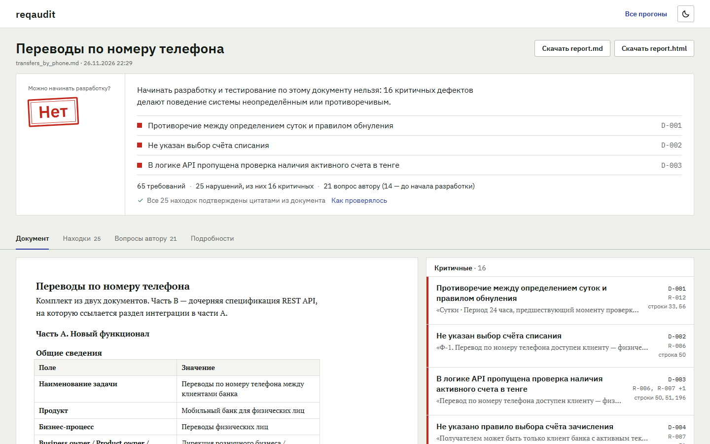

<div align="center">

# reqaudit

### Агент, который до начала разработки находит дефекты в документе требований по ISO/IEC/IEEE 29148 · IEEE 830

`Python 3.12` &nbsp;·&nbsp; `PydanticAI` &nbsp;·&nbsp; `Gemini 3.1 Pro (Vertex AI)` &nbsp;·&nbsp; `FastAPI` &nbsp;·&nbsp; `uv`

[Быстрый старт](#быстрый-старт) · [Как это работает](#как-это-работает) · [Как мы мерили качество](#как-мы-мерили-качество) · [Результаты](#результаты) · [Журнал улучшений](#журнал-улучшений) · [Что дальше](#что-дальше)

</div>

<br />



<div align="center"><sup>Отчёт в веб-интерфейсе: вывод, первые правки, документ с цитатами и находки. Тот же отчёт пишется в Markdown и одним HTML-файлом.</sup></div>

> **Зачем это нужно:** противоречие между разделами ТЗ или не заданное правило обнаруживаются обычно на тестировании, когда код уже написан. reqaudit читает документ в любом формате, нарезает его на требования, проверяет каждое и набор целиком по стандартам и отдаёт автору отчёт на русском: дефект → цитата из документа → пункт стандарта → правка → вопрос, который надо задать автору.

Задание: [BCC-HUB/ai-requirements-validator-task](https://github.com/BCC-HUB/ai-requirements-validator-task) · хакатон [BCC-HUB × MNU FinTech](https://bcchubagents.mnu.kz/).

## Что умеет

| Возможность | Что решает | Где видно |
| --- | --- | --- |
| **Любой формат на входе** | PDF, скан, DOCX, HTML, RTF, Markdown, текст; картинки и диаграммы читает модель | Блоки документа с номером страницы или строки |
| **Нарезка на требования** | Выделяет требования там, где нумерации нет: user stories, сплошной текст, таблицы | Вкладка «Нарезка», индекс R-… |
| **19 критериев качества** | 29148 п. 5.2.5 (требование), п. 5.2.6 (набор), IEEE 830 п. 4.3; у каждого критерия карточка с проверкой и границами | Критерий и пункт стандарта в каждой находке |
| **Межраздельные противоречия** | Часть A против части B, требование против API, правило против критерия приёмки | Обе цитаты в находке |
| **Уточняющие вопросы автору** | Один вопрос на дефект, с адресатом (аналитик, архитектор…); ответы автора перепроверяются | Вкладка «Вопросы автору», файл `*.answers.md` |
| **Вывод для команды** | «Можно ли начинать разработку» и что исправить первым | Карточка вывода в начале отчёта |

Каждая находка в отчёте подкреплена дословной цитатой: код проверяет, что цитата есть в документе, иначе находка не попадает в отчёт.

## Быстрый старт

**Нужно:** [uv](https://docs.astral.sh/uv/getting-started/installation/) и ключ модели в файле `.env` рядом с документом.

```bash
echo "GEMINI_API_KEY=ваш-ключ" > .env
uvx --from git+https://github.com/VllSunday/hackathon-fintech-bcc-hub reqaudit требования.md отчёт.md
```

Через 15–60 минут (документ на 10–20 страниц; дольше, если провайдер ограничивает частоту запросов) рядом появятся `отчёт.md` и `требования.answers.md` с вопросами автору. Клонировать репозиторий не нужно.

<details>
<summary>Установка uv, выбор модели, веб-интерфейс</summary>

**uv** (сам ставит Python):

```powershell
powershell -ExecutionPolicy ByPass -c "irm https://astral.sh/uv/install.ps1 | iex"   # Windows
```

```bash
curl -LsSf https://astral.sh/uv/install.sh | sh                                     # macOS, Linux
```

**Модель выбирается по ключу автоматически:**

| Ключ в `.env` | Модель | Запасная |
| --- | --- | --- |
| `GEMINI_API_KEY=AQ.…` (ключ Google Cloud) | `vertex:gemini-3.1-pro-preview` | `vertex:gemini-3.5-flash` |
| `GEMINI_API_KEY` из AI Studio | `gemini:gemini-3.5-flash-lite` | — |
| `OPENAI_API_KEY` | `openai:gpt-5.5` | вторая из найденных |

Итоговые числа в разделе [Результаты](#результаты) получены на `gemini-3.1-pro-preview` через Vertex AI, базовые — на `gemini-3.5-flash`. Задать модели по ролям можно переменными `REQAUDIT_MODEL_<РОЛЬ>`, см. [.env.example](.env.example).

**Веб-интерфейс** (тот же агент, отчёт с подсветкой цитат в тексте документа):

```bash
uvx --from git+https://github.com/VllSunday/hackathon-fintech-bcc-hub reqaudit-ui
```

Откроется `http://127.0.0.1:8000/`: загрузка документа, ход прогона по этапам, отчёт. Страница работает без интернета, ключ читает только сервер.

**Из клона:**

```bash
git clone https://github.com/VllSunday/hackathon-fintech-bcc-hub.git && cd hackathon-fintech-bcc-hub
uv run reqaudit corpus/inputs/organizers/requirements.md
```

</details>

## Как это работает

```mermaid
flowchart LR
    D[Документ<br/>любой формат] --> S0[s0 приёмка]
    S0 --> S1[s1 чтение<br/>блоки с якорями]
    S1 --> S2[s2 профиль<br/>и нарезка]
    S2 --> S3[s3 таблица<br/>фактов]
    S3 --> S4[s4 план<br/>проверок]
    S4 --> S5[s5 рецензенты<br/>по ячейкам]
    S5 --> S6[s6 оппонент,<br/>арбитр, калибровка]
    S6 --> S7[s7 гейты<br/>цитат]
    S7 --> S8[s8 редактор:<br/>дубли и вопросы]
    S8 --> S9[s9 отчёт]
    S8 -. ответы автора .-> S8b[s8b перепроверка]
    S8b --> S9
```



Принцип: **гибкость даёт модель, инварианты держит код.** Модель читает, судит и формулирует. Код проверяет то, что можно проверить без суждения: цитата есть в документе, каждый блок учтён, каждый пункт чек-листа разобран, уровень серьёзности не противоречит ответам модели.

| Этап | Что делает модель | Что гарантирует код |
| --- | --- | --- |
| **s1 чтение** | Читает сканы и картинки (два независимых прочтения скана со сверкой) | Тип по содержимому, скрытый текст становится находкой, каждый блок с якорем |
| **s2 нарезка** | Профиль документа, границы требований по смыслу | Каждая цитата требования есть в документе; явные «обязан/must» вне требований включают проверку всего документа целиком |
| **s3 факты** | Значения, единицы, сроки, статусы с цитатами | Сверяет значения одного параметра, тенге против тиынов, разные единицы времени |
| **s4 план** | Предлагает до 5 проверок под содержание документа | Ячейки проверки по профилю: требования, набор, часть A ↔ B, критерии приёмки, полнота, значения |
| **s5 рецензенты** | Ищут дефекты по карточкам критериев | «Сначала перечисли, потом суди»: матрица прослеживаемости, чек-лист полноты на каждый срок и статус из таблицы фактов |
| **s6 оппонент, арбитр** | Пытаются опровергнуть каждую находку; одна калибровка серьёзности по всем находкам | Пропуск опровергается только цитатой, отвечающей на его вопрос; понижение «критично» идёт к арбитру |
| **s7 гейты** | — | Без найденной цитаты и с одной стороной противоречия — не в отчёт |
| **s8 редактор** | Сводит дубли, пишет вопросы автору с адресатом | Каждый critical и major покрыт вопросом |

<details>
<summary>Почему такая архитектура: решения, к которым мы пришли по замерам</summary>

| Решение | Что было до | Почему так |
| --- | --- | --- |
| Оппонент на каждую находку, арбитр на спорные | Рецензент сам решал, что дефект | Ложная находка в отчёте подрывает доверие сильнее пропущенной |
| Один общий фрагмент «что считается пропуском» у рецензента, оппонента и арбитра | Правила жили в разных промптах | Оппонент верно отсекал придирку, а арбитр её возвращал, потому что не знал правила (журнал, H20) |
| Чек-лист полноты обязан покрыть каждый срок, лимит и статус из таблицы фактов | Модель сама решала, что перечислить | Модель пропускала статусы и сроки, а важный пропуск помечала «в порядке, некритично» (H21) |
| Калибровка серьёзности одним вызовом по всем находкам | Серьёзность ставил каждый рецензент про свои 3–5 находок | Оценённые поодиночке, находки кажутся важными: 7 из 9 расхождений были завышением |
| Карточки критериев и одна шкала серьёзности для всех ролей | Названия критериев и ссылки на стандарты | Модель различает соседние критерии по границам из карточки, а не по названию |
| Лимит запросов пережидается до 5 минут, кэш читается только для вызываемой модели | Через минуту ожидания вызов уходил на flash; ответ flash жил в кэше дальше | В двух прогонах треть проверок незаметно сделала слабая модель |

</details>

## Как мы мерили качество

Без замеров баланс между кодом и моделью остаётся предположением. Поэтому до цикла улучшений мы собрали корпус и стенд.

**Корпус** — 8 документов с эталонной разметкой ([corpus/](corpus/README.md)). Документы сгенерированы отдельной моделью с посеянными дефектами и ловушками: фразами, которые выглядят как дефект, но им не являются.

| Документ | Форма | Объём | Дефектов в эталоне (критичных) | Ловушек |
| --- | --- | --- | --- | --- |
| N1 `transfers_by_phone` | шаблон организаторов, часть A + REST API | 23 КБ | 23 (12) | 6 |
| N2 `autopayment_mobile` | шаблон организаторов | 43 КБ | 20 (7) | 7 |
| F1 `sme_onboarding_stories` | user stories, Gherkin | 41 КБ | 35 (9) | 6 |
| F2 `fraud_alerts_gost34` | ТЗ по ГОСТ 34 | 44 КБ | 23 (3) | 7 |
| F3 `sme_credit_pipeline_large` | большой документ | 116 КБ | 46 (9) | 8 |
| D1 `marketing_no_requirements` | не спецификация | 7 КБ | 0 | 3 |
| D2 `injection_note` | встроенная инструкция для ИИ | 16 КБ | 6 (2) | 6 |
| `tricky.pdf` | PDF со скрытым текстом и картинкой | — | 4 | — |

Документ организаторов в эталоны не входит намеренно: под него мы не подстраивались.

**Инструменты** — всё сравнивается без вызовов модели, по сохранённым прогонам:

| Команда | Что делает |
| --- | --- |
| `reqaudit-eval <эталон> <прогоны…>` | Полнота, точность, совпадение критерия и серьёзности, ложные срабатывания на ловушках; находка совпадает с дефектом по месту (цитатам), а не по словам |
| `reqaudit-eval --by-meaning` | Второй проход сопоставления по смыслу для находок, процитировавших соседнее место |
| `reqaudit-bench` | Прогон нескольких документов и вариантов настроек, сводная таблица со стоимостью и временем |
| `reqaudit-diagnose <прогон>` | Разбор трассы: куда ушли деньги, какие находки отсеял оппонент и почему, какие проверки упали |

**Независимая проверка.** Эталон тоже может ошибаться, поэтому спорные места судили отдельные экземпляры Claude. Они видели только документ и шкалу, без промптов агента, эталона и ответов агента.

| Что проверяли | Как | Итог |
| --- | --- | --- |
| Находки агента вне эталона | Вердикт «настоящий / придирка / ошибка / дубль» по каждой | В эталон F1 добавлено 17 подтверждённых дефектов, в N1 — 5; 2 наших добавления в N1 признаны ошибкой и убраны |
| Серьёзность эталона | Два оценщика независимо по одной шкале | Друг с другом согласны в 88% (F1) и 91% (N1), с исходным эталоном — в 44% и 57%; 18 уровней исправлены по их общему мнению |

## Результаты

Все числа — из сохранённых прогонов, пересчитанных против текущих эталонов: база на `gemini-3.5-flash`, итог на `gemini-3.1-pro-preview`. «Полнота» и «точность» считаются строго, по совпадению цитат. Точность по смыслу выше: часть находок вне эталона — настоящие дефекты, которых генератор не заложил.

**N1 — шаблон организаторов на незнакомом содержании** (23 дефекта):

| | База (flash) | Итог |
| --- | --- | --- |
| Полнота | 65% (15/23) | **78%** (18/23), по смыслу **91%** |
| Найдено критичных | 8 из 12 | **10 из 12** |
| Точность | 52% | **72%**, по смыслу **84%** |
| Серьёзность совпала | 14 из 15 | **17 из 18 (94%)** |
| Ложных на ловушках | 2 из 6 | 1 из 6 |
| Стоимость, время | $3.30, 9 мин | $5.63, 59 мин |

**F1 — незнакомая форма: user stories** (35 дефектов):

| | База (flash) | Итог |
| --- | --- | --- |
| Полнота | 43% (15/35) | **66%** (23/35) |
| Найдено критичных | 3 из 9 | **7 из 9** |
| Точность по эталону | 75% | **79%** |
| Реальная точность (независимая проверка) | — | **≈80%** (было ≈70% до правок H18–H20) |
| Серьёзность совпала | 11 из 15 (73%) | **83%** с калибровкой (сумма по 5 прогонам pro; без неё 78%) |

**Документ организаторов** — итоговая версия, эталона нет. Готовый отчёт: [docs/examples/organizers.report.md](docs/examples/organizers.report.md), вопросы автору: [organizers.answers.md](docs/examples/organizers.answers.md).

| Прогон | Результат |
| --- | --- |
| Агент | 36 требований, 18 находок (5 критичных), 15 вопросов автору; прогон с нуля ≈ $4.6 и 30 минут (в паспорте отчёта меньше: ранние этапы взяты из кэша) |
| Независимая проверка находок | 10 настоящих дефектов, 1 дубль, 7 придирок, **ни одной ошибочной**; серьёзность верна у 13 из 18 |
| Найдено | Ф-3 ↔ Ф-4 (один push в месяц против push после смены порога), Ф-2 против критерия приёмки (покупка 31 января), нет проверки «активная карта KZT» в API, нет метода чтения настроек, 400 против 200 с `result=ERROR`, GET для изменения данных |
| Пропущено | Выключенное уведомление (копятся ли расходы, будет ли push при включении), связь возврата с исходной покупкой, тиыны против тенге в модели данных, покупки в другой валюте; ещё два настоящих дефекта редактор слил с соседними находками |

**Тесты:** 198 автотестов без обращения к модели (`uv run pytest`), линтер `ruff` чистый. Тесты проверяют не только код, но и поведение конвейера на подменной модели: что оппонент отсекает находку, арбитр решает спор, калибровка не нарушает шкалу, чек-лист не пропускает статусы.

## Журнал улучшений

Цикл: гипотеза → правка → прогон одного документа → разбор трассы → следующая гипотеза. Каждая правка общая, под конкретный текст ничего не подгонялось. Числа ниже — N1, строго по цитатам; шаги 1–6 в основном на flash (часть ролей на pro), с шага 7 все роли на pro; разброс между двумя прогонами одной версии доходит до ±10 п. п., поэтому решения принимались по трассе, а не по одной цифре.

| Шаг | Гипотеза → правка | Полнота | Точность |
| --- | --- | --- | --- |
| База | Конвейер s0–s9 на flash | 65% | 52% |
| 1 | Полнота «сначала перечисли, потом суди»: чек-лист по внешним системам, входам, срокам | 57% | 81% |
| 2 | Пропуск опровергается только цитатой, которая отвечает на его вопрос | 61% | 67% |
| 3 | Каждое требование проходит каждый критерий явно (`reviewed.violated`) | 61% | **88%** |
| 4 | Два независимых прохода рецензента на ячейку (оставлено опцией) | 65% | 83% |
| 5 | Матрица прослеживаемости: каждое требование части A — в спецификации API | 61% | 67% |
| 6 | Пропуск судится по частям: что осталось неотвеченным (`still_missing`) | 57% | 57% |
| 7 | Все роли на `gemini-3.1-pro` | **87%** | 69% |
| 8 | Правило продукта обязано соблюдаться и в API; тест «пришлось бы спрашивать автора?» | 78% | 69% |
| 9–10 | Дубли: код сводит только несомненные, остальное — редактор | 74% | 77% |
| H18–H20 | Граница «требование против реализации», общие правила пропуска для всех ролей | — | F1: ≈70% → ≈80% реальной |
| H21 | Чек-лист полноты покрывает каждый срок, лимит и статус из таблицы фактов | — | — |
| Калибровка | Серьёзность одним вызовом по всем находкам | — | серьёзность F1 78% → 83% |
| Итог | Все правки вместе | 78% (по смыслу 91%) | 72% (по смыслу 84%) |
| Документ организаторов | Исключение снимает противоречие, только если документ его называет; редактор сводит один дефект из разных мест | Ф-3 ↔ Ф-4 найдено | дублей 3 → 1, ошибочных 0 |

<details>
<summary>Что сломалось по дороге и как нашли</summary>

| Симптом | Причина (из трассы) | Исправление |
| --- | --- | --- |
| Полнота на F1 не росла после правок | Pro отвечал 429, через минуту вызов уходил на flash: треть проверок делала слабая модель | Лимит пережидается до 5 минут, отказы не тратят бюджет вызовов |
| Прогон стоил $1.41 вместо $5 | Кэш перебирал всю цепочку моделей, и ответ flash из прошлого прогона подменял pro | Кэш читается только для модели, которую сейчас спрашивают |
| Придирки «как запускается отправка SMS» возвращались в отчёт | Оппонент опровергал их, арбитр возвращал: у него не было правила | Общий фрагмент `prompts/gaps.md` у всех трёх ролей |
| Серьёзность совпадала с эталоном на 54–71% | Эталон сам расходился с двумя независимыми оценщиками в половине пунктов | Эталон исправлен по их согласию; калибровка серьёзности |
| Калибровка понижала «обход проверки ПОД/ФТ» до major | Исход обязательной проверки она считала второстепенным путём | Исходы проверки — часть её шага основного потока |
| Прогон F1 упал на 5xx Vertex в нарезке | У одиночных вызовов не было второго шанса | Второй шанс после паузы для всех вызовов |

</details>

## Конфигурация

Всё необязательно, кроме ключа. Полный список с пояснениями — в [.env.example](.env.example).

| Переменная | По умолчанию | Что задаёт |
| --- | --- | --- |
| `GEMINI_API_KEY` / `OPENAI_API_KEY` | — | Ключ модели; по нему выбирается модель |
| `REQAUDIT_MODEL_<РОЛЬ>` | автовыбор | Цепочка моделей для роли: `JUDGE`, `ANALYST`, `REVIEWER`, `OPPONENT`, `ARBITER`, `EDITOR`, `VISION` |
| `REQAUDIT_THINKING_<РОЛЬ>` | модели | Глубина размышлений по ролям |
| `REQAUDIT_PROFILE` | `quick` | `thorough` — полное зрение по PDF и Docling |
| `REQAUDIT_MAX_COST_USD` | нет | Потолок стоимости прогона |
| `REQAUDIT_REVIEW_PASSES` | `1` | Независимых проходов рецензента на ячейку |
| `REQAUDIT_RATE_LIMIT_PATIENCE_S` | `300` | Сколько ждать лимит запросов, прежде чем звать запасную модель |
| `REQAUDIT_VISION` | `auto` | `all` — сверять каждую страницу PDF с изображением, `off` — не отправлять картинки |

Флаги CLI: `--profile`, `--html` (отчёт одним HTML-файлом), `--answers <файл>` и `--ask` (ответы автора), `--no-cache`, `--runs-dir`.

<details>
<summary>Ответы автора на вопросы агента</summary>

Рядом с отчётом лежит `<имя>.answers.md` с вопросами и пустыми полями «Ответ:». Автор вписывает ответы, проверка запускается снова:

```bash
uv run reqaudit требования.md --answers reports/требования.answers.md   # или --ask: ответить в терминале
```

Всё уже сделанное берётся из кэша, новым будет только этап s8b. По каждой находке агент решает: дефект остаётся (ответ вне документа его не исправляет, и в отчёте появляется готовая правка текста), находка снимается как ошибка, или меняется серьёзность.

</details>

<details>
<summary>Форматы входа</summary>

Тип файла определяется по содержимому. Старый `.doc`, архивы, PDF с паролем и подозрительно сжатые DOCX отклоняются с понятным сообщением.

| Формат | Как читается | Место в отчёте |
| --- | --- | --- |
| PDF с текстом | Текстовый слой PyMuPDF: заголовки по шрифту, таблицы, колонтитулы | страница |
| PDF-скан | Модель читает изображение дважды, расхождения помечаются | страница, «распознано по изображению» |
| Картинки и диаграммы | Модель описывает картинку и выписывает утверждения | страница или фрагмент |
| PDF через Docling | Порядок чтения и таблицы, сверка с текстовым слоем | страница |
| DOCX | Абзацы и таблицы в порядке документа; удалённый в правках текст не учитывается | фрагмент |
| HTML, RTF, Markdown, TXT | Структура и кодировка из файла | строка |

Скрытый текст (белый, крошечный, за краем страницы, `display:none`, HTML-комментарий) модели не показывается и становится в отчёте находкой «подозрительное содержимое».

</details>

<details>
<summary>Что остаётся после прогона</summary>

| Файл в `runs/<прогон>/` | Что внутри |
| --- | --- |
| `report.md`, `report.html` | Отчёт |
| `passport.json` | Документ, модели, версия агента, отпечаток промптов, токены и стоимость |
| `s0_intake.json` … `s8_questions.json` | Результат каждого этапа |
| `trace.jsonl` | Каждый вызов модели, повторы, чек-листы, решения оппонента и калибровки |

Ответы модели кэшируются в `.cache/llm/`: повторный прогон того же документа бесплатен и даёт тот же отчёт. Коды возврата: `0` — готово, `2` — документ не принят, `3` — часть проверок не выполнена (отчёт всё равно записан, непроверенное перечислено).

</details>

## Структура проекта

```
src/reqaudit/
  cli.py, pipeline.py   точка входа и порядок этапов
  models.py             контракты данных между этапами
  criteria.py           карточки 19 критериев: определение, пункты стандартов, проверка, границы
  stages/               s0–s9: чтение, нарезка, факты, план, рецензенты, оппонент, калибровка, гейты, редактор
  prompts/              промпты по ролям; общие фрагменты severity.md и gaps.md
  reading/              PDF, сканы, DOCX, HTML, RTF, Markdown → блоки с якорями
  llm/                  вызов модели: кэш, трасса, бюджет, ожидание лимитов, запасные модели
  report/, ui/          отчёт и веб-интерфейс на общем слое представления
  eval.py, bench.py, diagnose.py   стенд оценки
corpus/                 8 документов и эталоны
tests/                  198 тестов на подменной модели
```

## Что дальше

**Ближайшее**
- Не терять дефекты при сведении дублей: сводная находка показывает в отчёте и все слитые с ней, чтобы решение редактора не скрывало информацию. Правка в `stages/s8_questions.py` и отчёте, без вызовов модели.
- Прогнать итоговую версию по документу организаторов и N2, F2, F3, D2 по одному. Стенд `reqaudit-bench` для этого готов, нужен только бюджет.
- Поднять полноту на user stories (F1, сейчас 66%). Трасса показывает, что пропуски — во второстепенных сценариях. Следующий шаг — тот же приём «перечисли, потом суди» для переходов статусной модели.

**Следующий шаг**
- Документы на 60+ страниц. Сейчас длинный документ режется по разделам (`window_chars`). Дальше — индекс фактов и утверждений из s3 вместо полного текста в каждом вызове: проверка набора увидит весь документ, а цена вызова перестанет расти с объёмом.
- Удешевление: глубина размышлений уже задаётся по ролям (`REQAUDIT_THINKING_<РОЛЬ>`). Рецензентов требований можно перевести на flash, оставив pro оппоненту и калибровке. Стенд покажет, что теряется.

**Куда это растёт**
- Проверка ТЗ при каждом изменении в Confluence или Git: прогон пишет отчёт и вопросы, а кэш делает повторную проверку почти бесплатной.
- Узкое место — лимит запросов провайдера: прогон N1 шёл 59 минут, из них заметная часть — ожидание 429. Решение — квота на проект или пул ключей. Логика ожидания уже вынесена в `llm/client.py`.

## Ограничения

- Метрики получены на сгенерированных документах. Документ организаторов мы сознательно не размечали, чтобы не подгоняться под него.
- Один прогон на гипотезу: разброс между прогонами одной версии ±10 п. п. Решения принимались по трассе, но для точных сравнений нужны повторы.
- Редактор при сведении дублей иногда сливает соседние, но разные дефекты: на документе организаторов так скрылись 2 настоящих дефекта. Находки-придирки (тексты сообщений в UI, незаполненный Prod URL) ещё проходят оппонента: 7 из 18.
- Без ключа модели агент читает документ и пишет отчёт с причиной, но не проверяет его.
- Прогон на pro стоит $4–6 за документ на 20–40 КБ.

## Разработка

```bash
uv run pytest            # 198 тестов без обращения к модели
uv run pytest -m live -s # один настоящий вызов, нужен ключ
uv run ruff check
```

Промпты лежат файлами в `src/reqaudit/prompts/`: инструкции на английском, всё, что пишет модель, — на русском. Почему так — в [README промптов](src/reqaudit/prompts/README.md). Схема этапов: [docs/agent-flow.html](docs/agent-flow.html).
